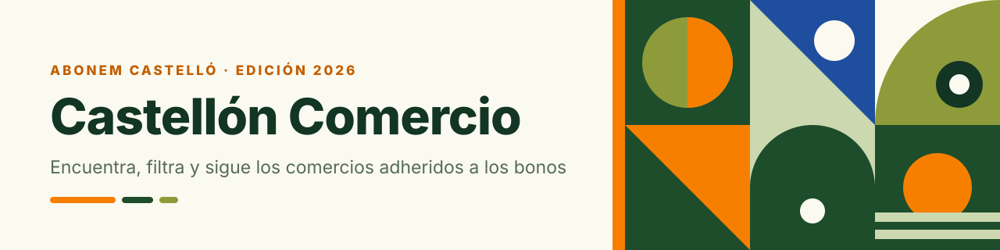
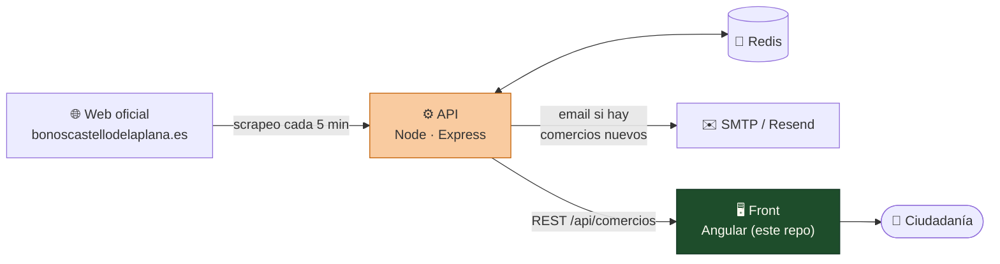
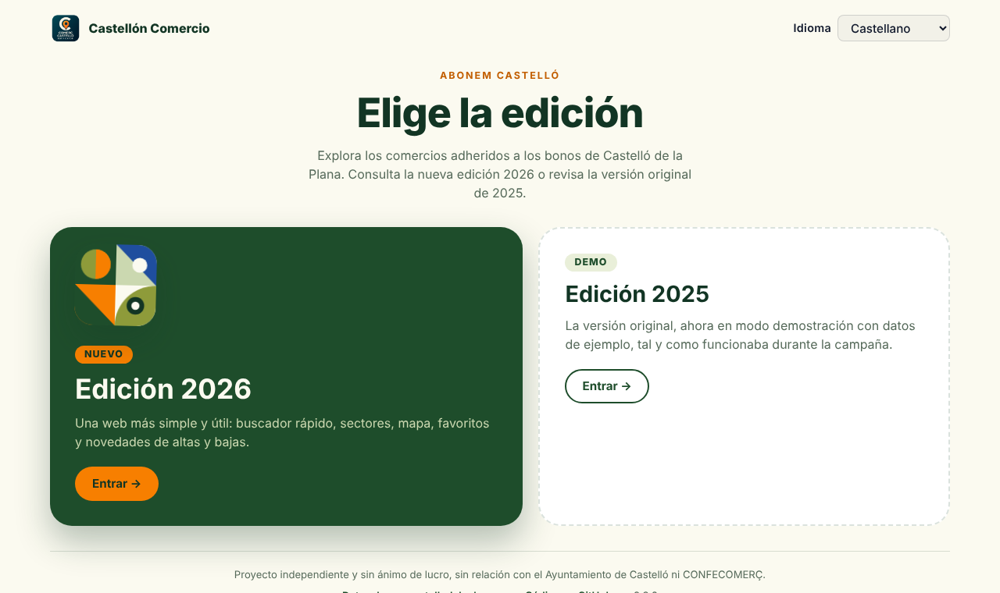
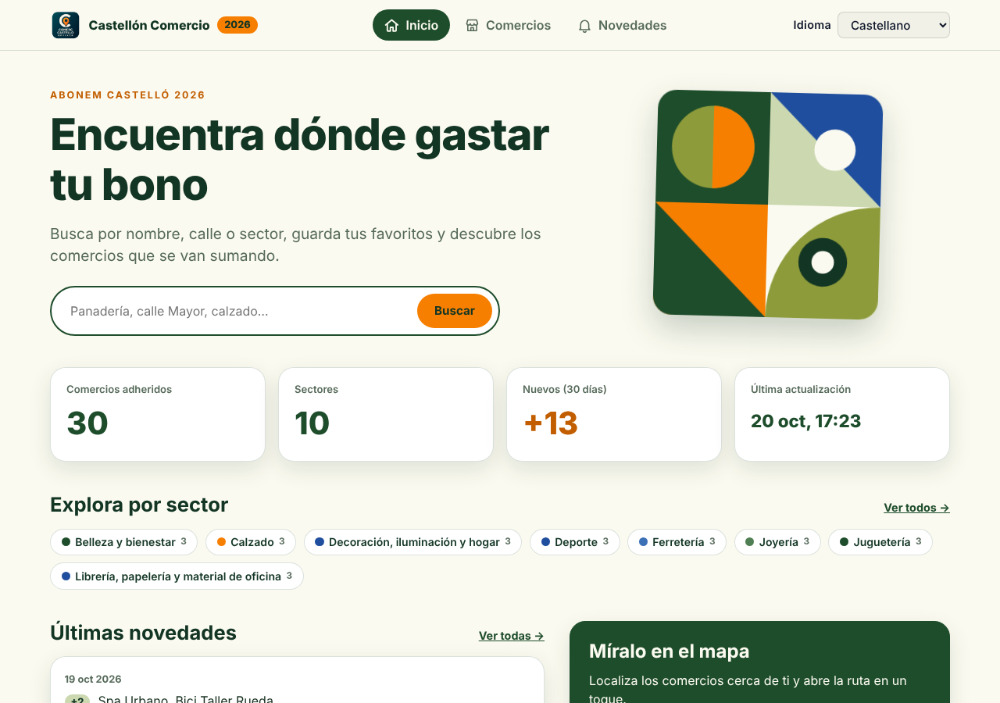
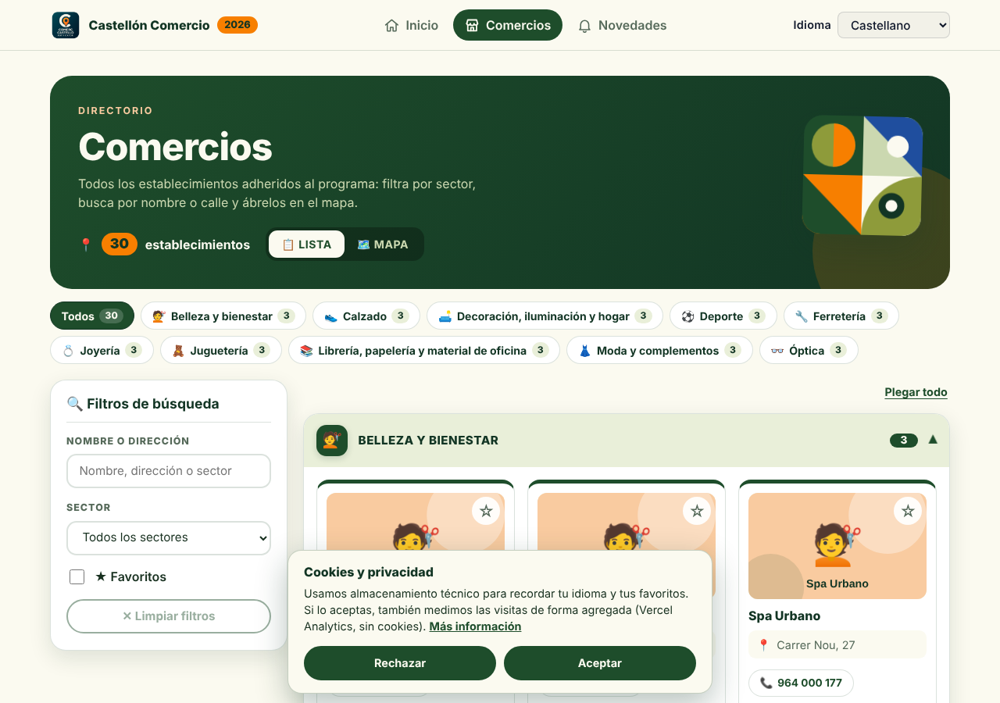
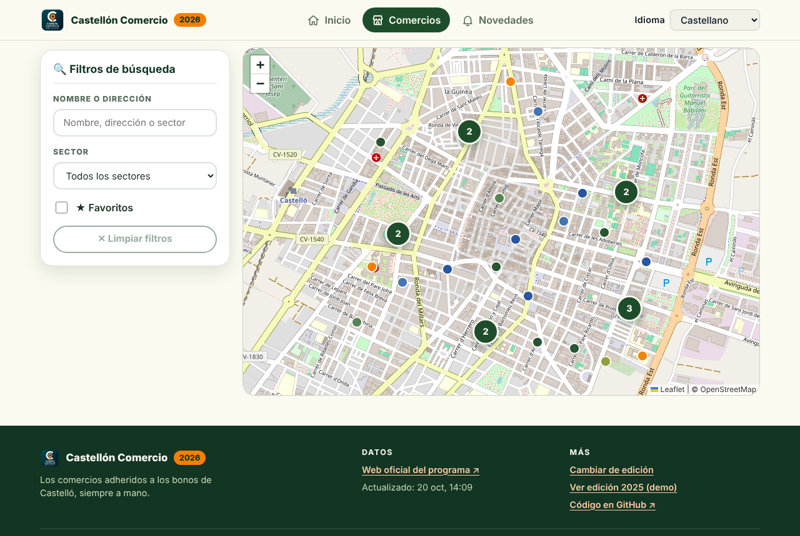
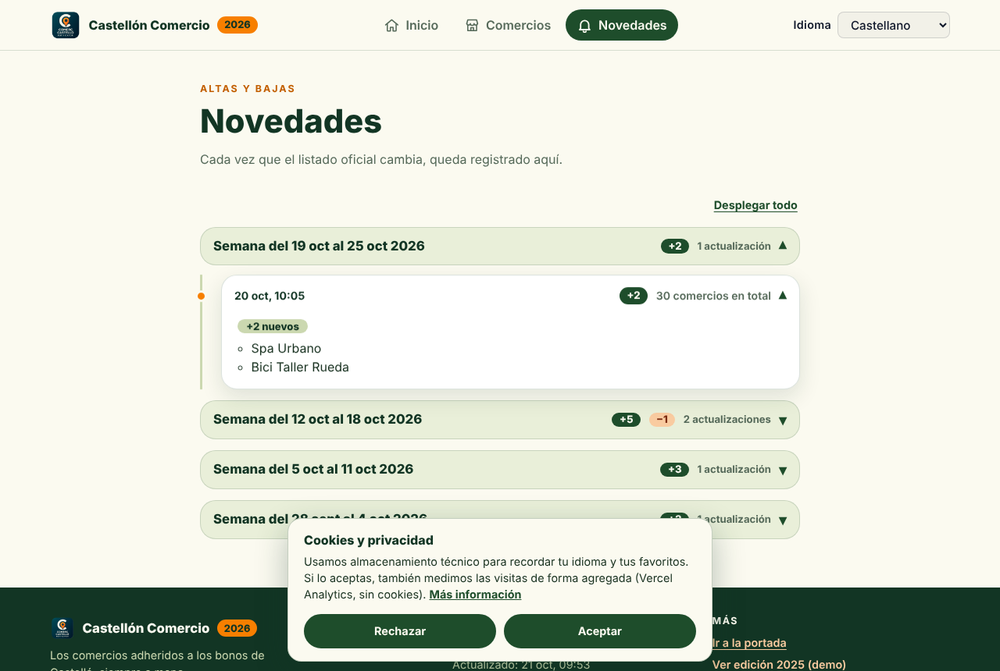
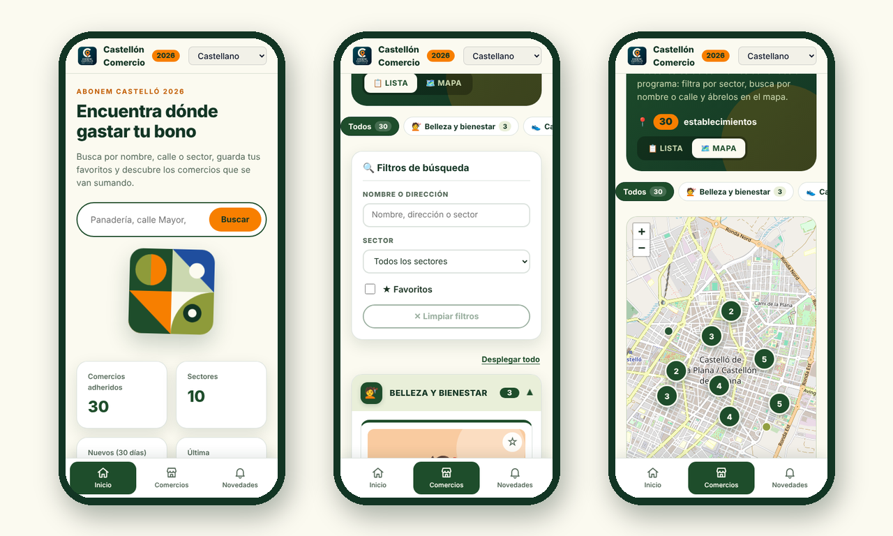
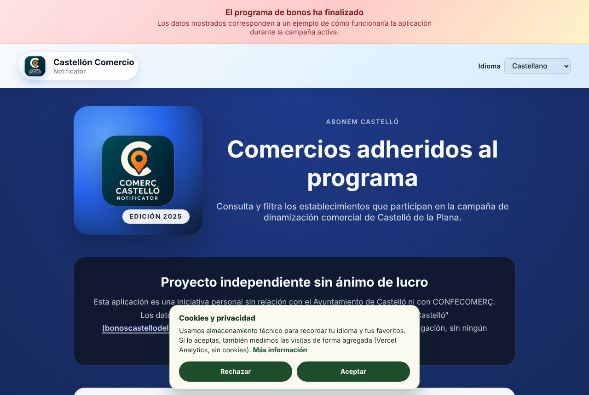

<div align="center">




# Castellón Comercio · Front

**Encuentra, filtra y sigue en un mapa los comercios adheridos a los bonos de Castelló de la Plana.**
<br>Dos ediciones en una sola web: la **2025** (demo) y la **2026** (renovada).

[](https://bono-castellon.alvaromaxter.es/)

[](https://github.com/ElMaxter99/castellon-comercio-notificator-front/actions/workflows/ci.yml)
[](CHANGELOG.md)
[](https://angular.dev)
[](https://www.typescriptlang.org)
[](https://leafletjs.com)
[](https://vercel.com)
[](public/i18n)

[🌐 Web pública](https://bono-castellon.alvaromaxter.es/) · [Capturas](#-capturas) · [Ecosistema](#-ecosistema) · [Arranque rápido](#-arranque-rápido) · [Documentación](#-documentación) · [⚙️ API](https://github.com/ElMaxter99/castellon-comercio-notificator-api)

</div>

> [!NOTE]
> **Iniciativa independiente y sin ánimo de lucro.** No guarda relación con el Ayuntamiento de Castelló de la Plana ni con CONFECOMERÇ. Los datos proceden de la web oficial del programa y se ofrecen solo con fines informativos.

---

## ✨ ¿Qué es?

La web oficial del programa ofrece un listado paginado sin buscador cómodo, sin mapa y sin histórico. Este proyecto lo convierte en una experiencia útil:

- 🔎 **Buscador** por nombre, dirección o sector (tolera acentos).
- 🗂️ **Lista agrupada por sector** o 🗺️ **mapa con clústeres**, con contador de establecimientos.
- ⭐ **Favoritos** guardados en tu navegador y 🔗 filtros compartibles por URL.
- 🔔 **Novedades**: altas y bajas del listado a lo largo del tiempo.
- 🌍 Castellano y valencià, responsive y con accesibilidad en mente (`prefers-reduced-motion`, ARIA, teclado).

## 🧭 Ecosistema

Este repositorio es **solo el front**. Los datos los produce el [**API**](https://github.com/ElMaxter99/castellon-comercio-notificator-api), que vigila la web oficial y avisa de los cambios.



| Repositorio | Qué hace | Documentación |
|---|---|---|
| 🖥️ **Front** (este) | Web Angular con las ediciones 2025 y 2026 | [`docs/`](docs) · [`CLAUDE.md`](CLAUDE.md) |
| 🌐 **Web pública** | La web en producción ([alternativa en Vercel](https://castellon-comercio-notificator-fron.vercel.app/)) | [bono-castellon.alvaromaxter.es](https://bono-castellon.alvaromaxter.es/) |
| ⚙️ [**API**](https://github.com/ElMaxter99/castellon-comercio-notificator-api) | Scraper, Redis, histórico, avisos por correo y REST | [`docs/`](https://github.com/ElMaxter99/castellon-comercio-notificator-api/tree/develop/docs) |

## 📸 Capturas

> Todas las capturas usan **datos ficticios** (comercios, fotos, teléfonos y fechas inventados); no se muestran datos reales del programa. Se regeneran con [`tools/readme-screenshots.cjs`](tools/readme-screenshots.cjs).

### Selector de edición

<p align="center"></p>

### Edición 2026

<table>
  <tr>
    <td width="50%"><br><sub><b>Inicio</b> · buscador, cifras, sectores y novedades</sub></td>
    <td width="50%"><br><sub><b>Comercios</b> · filtros laterales y lista por sector</sub></td>
  </tr>
  <tr>
    <td width="50%"><br><sub><b>Mapa</b> · clústeres numerados y filtros</sub></td>
    <td width="50%"><br><sub><b>Novedades</b> · línea de tiempo de altas y bajas</sub></td>
  </tr>
</table>

### En el móvil

<p align="center"></p>

### Edición 2025 (demo)

<p align="center"><br><sub>Las vistas originales, congeladas y siempre con datos de ejemplo.</sub></p>

## 🗓️ Ediciones

| Ruta | Edición | Datos |
|---|---|---|
| `/` | Selector de edición | — |
| `/2026` · `/2026/comercios` · `/2026/novedades` | **2026** — vistas renovadas | API real (configurable) |
| `/2025` · `/2025/history` | **2025** — vistas originales | **Siempre demo** (`public/mockup/`) |

Cómo se fuerza el modo demo en 2025 y cómo está montado el diseño 2026: [`docs/EDITIONS.md`](docs/EDITIONS.md).

## 🚀 Arranque rápido

**Requisitos:** Node.js ≥ 20.19 (o 22.12+) y npm.

```bash
git clone https://github.com/ElMaxter99/castellon-comercio-notificator-front.git
cd castellon-comercio-notificator-front
npm install

npm start                      # http://localhost:4200 contra el API en http://localhost:12001
npm start -- --live=false      # sin API: datos mock de public/mockup (solo afecta a 2026)
npm test                       # Karma + Jasmine (el CI lo ejecuta en cada PR)
npm run build -- --configuration=production
```

### 🔌 Apuntar a tu propio API

La URL se fija **al compilar**, sin tocar código:

```bash
# variable de entorno (también en Vercel: Project Settings → Environment Variables)
API_BASE_URL=https://mi-api.onrender.com npm run build -- --configuration=production

# o con flag
npm start -- --api-url=http://localhost:3000
```

Prioridad: `--api-url` › `API_BASE_URL` › valor por defecto del entorno. Detalles en [`docs/ENVIRONMENTS-AND-MOCK.md`](docs/ENVIRONMENTS-AND-MOCK.md). Para montar tu propio backend gratis: [guía de hosting del API](https://github.com/ElMaxter99/castellon-comercio-notificator-api/blob/develop/docs/HOSTING.md).

## 🧱 Arquitectura

```
src/app/
├── app.ts · app.routes.ts          raíz: router-outlet + toasts, rutas por edición
├── pages/landing/                  selector de edición (/)
├── editions/
│   ├── edition-2025/               layout original (siempre demo)
│   └── edition-2026/               shell, store, páginas (inicio · comercios · novedades), tema, mapa
├── components/                     UI de la edición 2025 y compartida
├── services/                       CommerceService (único acceso a datos), idioma, toasts, DATA_MODE
├── models/                         Commerce · CommerceStatus · CommerceHistoryEntry
└── utils/                          búsqueda sin acentos, coordenadas, fechas
```

Angular 20 con componentes *standalone*, `signal`/`computed`, `OnPush` y rutas perezosas. Mapa con Leaflet + `markercluster`; traducciones con ngx-translate. Más en [`docs/ARCHITECTURE.md`](docs/ARCHITECTURE.md).

## 📚 Documentación

| Documento | Contenido |
|---|---|
| [`docs/EDITIONS.md`](docs/EDITIONS.md) | Ediciones 2025/2026, modo demo forzado, diseño, animaciones y footers |
| [`docs/ARCHITECTURE.md`](docs/ARCHITECTURE.md) | Árbol de componentes, estado, datos, mapa, i18n |
| [`docs/ENVIRONMENTS-AND-MOCK.md`](docs/ENVIRONMENTS-AND-MOCK.md) | Entornos, `--live`, `API_BASE_URL`, mock y builds |
| [`docs/DEPENDENCIES.md`](docs/DEPENDENCIES.md) | Dependabot: subidas ignoradas a propósito, ruta de migración y cómo revisar sus PRs |
| [`docs/REUSE-2026.md`](docs/REUSE-2026.md) | Checklist para reutilizar el proyecto en una nueva edición |
| [`CHANGELOG.md`](CHANGELOG.md) | Historial de versiones |
| [`CLAUDE.md`](CLAUDE.md) | Guía del proyecto para trabajar con Claude Code |

La documentación del backend (endpoints, scraper, operación, hosting) está en el [repositorio del API](https://github.com/ElMaxter99/castellon-comercio-notificator-api#-documentaci%C3%B3n).

## 🤝 Contribuir

1. Haz un *fork* y crea una rama desde `develop` (flujo gitflow).
2. `npm install`, desarrolla con `npm start` y comprueba `npm test`.
3. Todo texto visible va en **ambos** idiomas (`public/i18n/`).
4. Abre una *pull request* explicando el cambio.

## 📝 Licencia

Uso informativo y sin fines comerciales. Respeta siempre las condiciones de uso de los datos oficiales del Ayuntamiento de Castelló de la Plana.

<div align="center"><sub>Hecho con 💚 en Castelló · colores y formas inspirados en el cartel de la edición 2026</sub></div>
